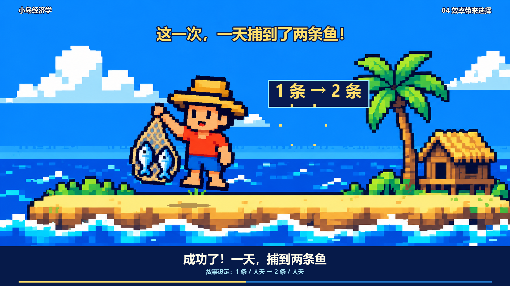

# 小岛经济学 · 海蓝像素知识视频

用简单海蓝像素动画讲清储蓄、机会成本、资本形成和劳动生产率。包含 **86.1 秒中文男声旁白成片**、可编辑 Python 源码、背景、人物姿态、旁白和字幕，适合想制作知识短视频的人。



## 直接下载，不需要安装软件

- **[下载 MP4 视频（1080p，中文旁白，无背景音乐）](https://github.com/caojinzhi695-ctrl/island-economics-pixel-video/releases/download/v1.0.0/island-economics-narrated.mp4)**
- **[下载完整项目 ZIP](https://github.com/caojinzhi695-ctrl/island-economics-pixel-video/archive/refs/heads/main.zip)**
- **[进入发布页](https://github.com/caojinzhi695-ctrl/island-economics-pixel-video/releases/tag/v1.0.0)**

这是公开仓库，访客可以下载。视频也保存在 [downloads](downloads/)；在文件页面点击 Download raw 即可。下载公开可用不代表可以忽略第三方服务或素材的使用条件，详见 [来源与使用说明](docs/SOURCES.md)。

## 已实现

- 1920×1080，30 fps，横屏海蓝像素动画，字幕已烧录。
- 27 句中文旁白，逐句测量时长，让镜头配合说话，不截断句尾。
- 捕鱼姿态变化、织网节奏、跳跃庆祝、呼吸与局部镜头缓推。
- 可输出约 76 秒无旁白版，或约 86 秒旁白版；旁白有无背景音乐均可。
- 保留旁白音频缓存，原文案无需再次调用在线语音服务即可重新渲染。

## 安装与重新渲染（开发者）

本项目不是双击即用的软件。已在 Windows / Python 3.12 环境验证；需要中文字体。建议 Python 3.12、Git、可联网的 pip。FFmpeg 由 imageio-ffmpeg 提供。edge-tts 通过微软在线语音服务生成新旁白；本项目不要求填写 API Key，也未配置付费服务，但不保证该在线服务永久可用。

```powershell
git clone https://github.com/caojinzhi695-ctrl/island-economics-pixel-video.git
cd island-economics-pixel-video
py -3.12 -m venv .venv
.\.venv\Scripts\python.exe -m pip install -r requirements.txt
.\.venv\Scripts\python.exe make_narrated.py
```

成片输出到 `style02-narrated/renders/`。原始下载成片留在 `downloads/`，不会被重新渲染覆盖。脚本会输出中文旁白版与仅旁白无配乐版；默认不含第三方背景音乐，前者只有旁白和合成提示音。

### 修改内容

例如把结尾问题改成“你正在学习什么新技能？”：修改 `make_narrated.py` 的 `LINES` 最后一项，并同步修改 `make_rhythm.py` 的 `CUTS` 最后一条字幕。删除对应缓存 `style02-narrated/audio/lines/26.mp3`，再运行渲染命令。修改其他句子时删除对应序号缓存；**未删除缓存时会继续复用旧语音**。当前 `CUTS` 和 `LINES` 必须保持 27 项、一一对应；这不是任意主题的一键自动改编系统。

只生成无旁白版本：运行 `python make_rhythm.py`。调整声音可修改 `VOICE`、`RATE`；更换声音后须删除全部句子缓存再生成。

可选音乐：把有权使用的音频放到 `audio/bgm.mp3`，或在 PowerShell 中设置 `$env:BGM_PATH = 'D:/音乐/自己的音乐.mp3'`。不要把未授权音源提交到仓库。中文字体默认使用 Windows 微软雅黑；其他系统设置 `CHINESE_FONT` 与 `CHINESE_FONT_BOLD` 为本机字体路径（尚未验证跨平台全片渲染）。

## 目录

| 路径 | 内容 |
| --- | --- |
| `downloads/` | 可直接播放的无配乐中文旁白 MP4 |
| `make_narrated.py` | 旁白生成、时间线调整、混音、视频导出 |
| `make_rhythm.py` | 27 段节奏版与人物动作 |
| `make_style02.py` | 海蓝像素场景绘制 |
| `make_film.py`、`story.json` | 底层绘图、字体、故事数据；支持模块 |
| `style02/assets/` | AI 生成的背景和六姿态透明精灵图 |
| `style02-narrated/audio/` | 27 段旁白缓存与完整旁白 WAV |
| `style02-narrated/字幕.srt` | 逐句时间字幕 |
| `audio/analysis.json` | 节奏时间点数据，不包含原音乐 |
| `docs/` | 来源、验证与预览 |

## 限制与说明

人物采用六姿态图配合旋转、拉伸、位移，不是完整骨骼动画。原配乐及其混音视频未上传；未附带第三方仓库、虚拟环境、字体文件和个人配置。故事中的一条鱼变两条鱼是简化设定，半天工作需额外假设产出与时间成正比；更多鱼与更多闲暇是两种选择，不能重复计算。

详见 [验证记录](docs/VALIDATION.md)、[来源与概念说明](docs/SOURCES.md)、[更新记录](CHANGELOG.md)。
